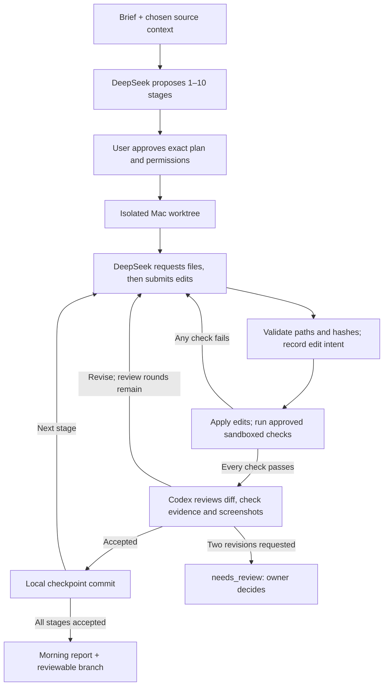

# Overnight coding on the Mac

## What this adds

A large request becomes one approved, ordered plan. **DeepSeek writes the plan and does the implementation** through the existing single service across both Sparks; the Mac coordinator owns permissions, edits, checks, attempts, deadlines, checkpoint commits and the event history. By default, **Codex reviews finished evidence** after checks pass, at most two calls per stage. The owner may explicitly request one pre-stage guidance call. Codex does not write routine assignments or edit code.

The original `npm run demo` and `npm run live -- --brief <file>` commands remain available.



A failed required check cannot be overridden by a model, and it never spends a Codex call. If DeepSeek exhausts its attempts the stage stops at `needs_review`; grant more DeepSeek attempts with `--extend-attempts`, revise the plan, or inspect the worktree yourself. Every new stage starts with DeepSeek again. There is no merge, push, deployment or Spark configuration change.

## Start inside Codex CLI

Open Codex CLI in this repository and say:

> Use overnight-build to build this feature in [target repository]: [your large request].

The repository skill is in `.agents/skills/overnight-build/SKILL.md`. Repository discovery follows the [official skill documentation](https://learn.chatgpt.com/docs/build-skills). The skill resolves the target, prepares the brief/permissions, shows the proposed stages and asks for approval of that concrete record. It then launches the runner and reports its job ID.

Before planning, select which source may be read. Planning sends the selected source to **DeepSeek on your own Sparks**, not to Codex. Codex receives only the current diff, changed files (capped at 64 KiB), check output and screenshots, so whole-repository source never leaves the Mac on a Codex call. Secrets and coordinator metadata are excluded. Source selection is still the user's decision.

## Codex usage discipline

Codex is the scarce resource; DeepSeek time is not. The runner therefore spends Codex only where a machine cannot decide:

| Work | Who does it | Codex calls |
| --- | --- | --- |
| Break the brief into stages | DeepSeek (`--planner deepseek`, default) or the built-in template (`--template`) | 0 |
| Write each stage assignment | Coordinator, from the already-approved stage text | 0 |
| Optional guidance before a stage starts | Codex, only through an explicit `guide` command | 1 maximum per stage |
| Implement, read files, submit edits | DeepSeek | 0 |
| Run approved checks and judge pass/fail | Mac sandbox | 0 |
| Independent review of a passing stage | Codex, once checks pass | 1 per review, max 2 per stage |
| Repair after 5 failed attempts | DeepSeek, when the owner grants `--extend-attempts` | 0 |

`--planner codex` is an opt-in escape hatch capped at one planning call, including malformed responses; it exists in case a DeepSeek plan turns out too coarse. `guide --job JOB_ID --stage STAGE_ID` is a separate explicit one-call hint for the next unfinished stage, before its first attempt. The hint is added to DeepSeek's coordinator-composed assignment and cannot expand the approved plan or permissions. `report.md` and `status --json` record planning, guidance, and review calls (`codexCalls`) and their duration. Provider failures also consume the relevant call limit.

## Prepare the disposable UI pilot

On the Mac, from the Orchestrator checkout:

```sh
npm run pilot -- /path/to/new-disposable-pilot
```

The destination must not exist. Preparation copies the React/TypeScript starter, installs pinned dependencies with `npm ci`, downloads Chromium into local `node_modules`, verifies the baseline builds, and commits the starter and protected checks. This is the only dependency-install phase. Node 24 is the tested runtime for this pilot. It requires a working package registry/download connection during preparation.

The requested app is **Night Shift**, a task board. `examples/overnight-brief.md` specifies three implementation stages (layout, interactions, persistence/accessibility) and final integration verification. `examples/overnight-permissions.json` permits `src/` edits and declares four protected checks. The starter intentionally does not pass the feature checks.

For the first **real** coding smoke test, use the smaller `examples/live-pilot-brief.md` and `examples/live-pilot-permissions.json` against the same clean starter. They request only the responsive shell and its final layout verification. This still requires exact plan approval, an isolated worktree, a real DeepSeek edit, the protected layout check, screenshots, and a separate Codex review. It does not satisfy the full four-stage Night Shift release gate.

The checks build the app, run Chromium, test behavior, and capture desktop/mobile PNGs. Browser requests are fulfilled from local build files through [Playwright routing](https://playwright.dev/docs/api/class-page#page-route); no localhost server or network grant is needed. Chromium uses a single process under the outer Codex Mac sandbox. Baseline accessibility checks cover labels, landmarks, keyboard interaction and a live region; they are not a full accessibility audit.

## Command contract

Use `node src/project-cli.mjs ...` or `npm run --silent project -- ...`. `--json` produces structured output. Paths and IDs below are placeholders.

```sh
npm run --silent project -- plan --repo /path/to/project \
  --brief examples/overnight-brief.md --permissions examples/overnight-permissions.json --json

# Zero-model alternative: one implementation stage + final verification
npm run --silent project -- plan --repo /path/to/project --template \
  --brief examples/overnight-brief.md --permissions examples/overnight-permissions.json --json

# After reviewing and approving the returned manifest:
npm run --silent project -- approve --job JOB_ID --hash PLAN_HASH --json
# Optional, before the next stage has started; this spends one Codex call:
npm run --silent project -- guide --job JOB_ID --stage STAGE_ID --json
npm run --silent project -- run --job JOB_ID --background --json
npm run --silent project -- watch --job JOB_ID
npm run --silent project -- status --job JOB_ID --json
npm run --silent project -- stop --job JOB_ID --json
npm run --silent project -- resume --job JOB_ID --background --json

# Only after explicitly authorizing additional time or more DeepSeek attempts:
npm run --silent project -- resume --job JOB_ID --extend-hours 2 --background --json
npm run --silent project -- resume --job JOB_ID --extend-attempts 3 --background --json
```

`plan` accepts `--planner deepseek|template|codex` (default `deepseek`), `--hours` (default 8, up to 24) and `--fake`. `--data-dir` selects local job storage; use the same location on later commands. `run` without `--background` stays in the foreground. Exit codes: 0 for successful commands/accepted jobs, 2 for paused/blocked/needs_review/interrupted jobs, 1 for failures. A background launch confirms startup, not eventual success; use status/report for the outcome.

Limits per stage: five DeepSeek attempts, two Codex review calls, and one optional explicit guidance call before the first attempt. A stage is accepted only when every approved check passes **and** Codex accepts the evidence. A blocking review or a spent review budget stops the stage with the worktree preserved; more DeepSeek attempts alone cannot restore a spent review budget.

`watch` replays the private job log, then follows new events until the current run finishes. It shows the composed stage assignment, each DeepSeek file request/edit submission, applied edits, checks, Codex review calls with their duration, checkpoints, provider waits, and final status. `--once` prints the current history and exits. `--full` or `--json` prints each complete JSONL event, including full model inputs and responses; use it only in a terminal where that private source content is appropriate. A fake job is visibly marked `[FAKE]` in the human timeline. The timeline is a view of events already persisted by the coordinator, so it can reconnect after the viewer closes without changing the runner.

For a read-only browser view of the same saved handoffs, run `npm run dashboard -- --job JOB_ID` in Mac Terminal and open the printed local URL. The page refreshes every two seconds. It shows stages, model handoffs, checks, screenshots and expandable recorded payloads. It listens only on `127.0.0.1`, does not control the runner, and may display private source and model content from the job log. Stop the viewer with Ctrl-C; closing it does not stop a coding job. Use `--port 0` to select a free port.

Replanning a paused job:

```sh
npm run --silent project -- plan --job JOB_ID --brief revised-brief.md \
  --permissions revised-permissions.json --json
npm run --silent project -- approve --job JOB_ID --hash NEW_PLAN_HASH --json
npm run --silent project -- resume --job JOB_ID --background --json
```

This appends a new plan version. Existing stage IDs/order and accepted stages are preserved, consumed attempts and review rounds remain consumed, and assignments are recomposed from the approved stage text. A different stage structure needs a new job. Broader permissions never take effect without the new hash approval. Prepare newly authorized dependencies before resuming; existing worktrees do not automatically install or refresh packages.

## Providers and process lifetime

- Authenticate Codex CLI on the Mac. Stage reviews and explicitly requested planning or guidance use ephemeral structured `codex exec` calls; tool features are disabled for these calls and model output is interpreted only by the coordinator. The same installed CLI binary is used as the local OS sandbox (`codex sandbox`) for running checks — that is a local process, not a model call and it spends no usage. Authentication stays in the existing CLI login.
- Set `DEEPSEEK_BASE_URL` to the existing OpenAI-compatible API including `/v1`. Optionally set `DEEPSEEK_MODEL_ID`; without it exactly one model must be advertised. Planning and all implementation go to this endpoint. Set `FRONTIER_MODEL_ID` only if you want an explicit Codex model for reviews. Keep these settings in the environment, outside tracked files.
- The detached process inherits those settings, redirects output to its local `runner.log`, holds a job lock and uses `caffeinate`. Closing the conversation does not stop it. Power loss, reboot, suspension and account limits can still interrupt it.
- A transient provider error waits with bounded backoff, up to 30 minutes. Waiting does not consume extra attempts or extra review rounds. Authentication/configuration/scope errors pause immediately. Per-call timeouts remain finite (Codex 5 minutes, DeepSeek 10 minutes).
- The eight-hour deadline is wall clock time from the first run, including provider waits and downtime. Restarts do not reset it. Resume after expiration requires an explicit extension.

## Files, execution and recovery

The initial target must be a clean Git repository. The branch is `orchestrator/<job-id>` from the selected committed revision. The worktree lives in ignored `.data/artifacts/<job-id>/worktree`. Accepted stages become local commits; unfinished edits are retained for inspection. The source checkout stays separate.

The structured worker protocol permits up to ten file-request exchanges followed by one edit batch per attempt. A batch contains at most 30 UTF-8 writes/deletions, with expected SHA-256 hashes (null means the file must not exist). Files are capped at 128 KiB and combined context/diff is bounded. Stale hashes or malformed submissions consume an attempt and generate repair feedback. Path traversal, symlinks, protected files and scope expansion pause the job. Dependency manifests, Git metadata, secrets, instructions, checks and coordinator state cannot be worker-edited.

Only approved literal command arrays run. The installed Codex Mac sandbox grants read access to approved source, prepared dependencies and system runtime files. It denies tracked files outside approved read paths, common secret paths, Git metadata and network access. Only `dist/` and `.overnight-output/` are writable. A startup probe verifies private reads/source writes/network connections are denied and artifact writes work. An unavailable sandbox blocks the run. Checks that require another writable output directory are not supported by this first version.

The log at `.data/jobs/<job-id>.jsonl` records exact model inputs/results, plan versions/approval, attempts, intent before edits, applied hashes, full command output, reviews, checkpoint commits and provider usage when supplied. Artifacts and `report.md` live alongside the worktree. These are private local records, not public documentation.

On resume, recorded responses and checks are reused and accepted stages are skipped. Interrupted edit batches reconcile each file against its before/after hash before completing the transaction. External source/HEAD changes pause for inspection. A response lost before it was durably recorded may need another provider call; no exactly-once network-delivery claim is made. Codex review calls are recorded as `frontier.call` events so a resumed job never re-spends a review round it already used. A partial final JSONL fragment is preserved separately before locked recovery. A malformed lock or conflicting workspace requires inspection rather than automatic overwriting.

## Verification and release gate

`npm test` uses fake providers and injected checks for deterministic coordinator tests. The checks cover stage ordering, approval binding/versioning, failed checks, the attempt limit, the two-round review limit, review-only-when-checks-pass, extra-attempt resumes, context limits, provider recovery, auth pauses, deadlines, stop/resume, stale edits, protected scope, interrupted batches, external changes and duplicate locks.

After preparing a disposable pilot, run the offline integration exercise:

```sh
node scripts/verify-pilot.mjs /path/to/prepared-disposable-pilot
```

This uses a local HTTP stub with scripted responses and scripted frontier review, including a deliberately malformed first response. It performs real worktree edits, sandboxed builds/browser checks, screenshots and checkpoint commits. Its report is explicitly labeled **scripted**. It does not measure DeepSeek quality or replace the live release gate.

The live release gate remains: reconnect the existing service; verify `/v1/models`; verify the original text handoff; verify a structured coding response; run the staged pilot with real Codex and DeepSeek; inspect every accepted checkpoint, screenshot/check result and final report. Record observed results without credentials or machine-specific connection details. See `VERIFICATION.md` for dated observations.
