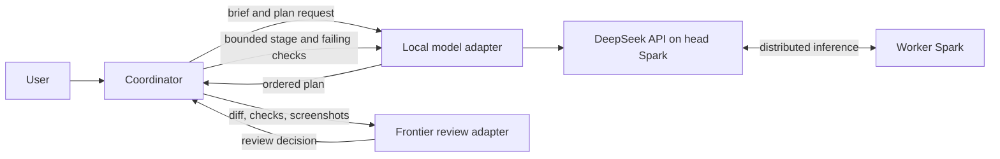

# Product context and decisions

This is the public handoff for Frontier Orchestrator. It describes the current direction rather than every idea in the original October 2026 brief. The developer's local `PROJECT_MEMORY.md` may contain hardware-specific observations and is intentionally excluded from Git.

## Why this exists

Using several models on one job currently means copying prompts and responses between tools, reconstructing context, and reconciling different plans. Frontier Orchestrator should let a user state the outcome once. The application carries one accepted plan, assigns focused work, records what happened, and shows what was checked and what remains uncertain.

Success means a useful result with less manual coordination. A large amount of local-model activity by itself is not success.

## Current role split

The optional Frontier Harness approved on2026-10-28 adds versioned collaboration
modes and bounded learning; see [HARNESS.md](HARNESS.md). Its collaborative mode
allows direct Codex execution and takeover. The role split below remains the
contract for existing text and overnight workflows, rather than restricting
explicitly selected harness modes. The harness remains under validation.

- **User:** states the goal and accepts the first plan for the initial workflow.
- **Local model:** turns the brief into an ordered plan and does substantial, well-scoped implementation work. The first integration calls an already-running DeepSeek service through its OpenAI-compatible API.
- **Frontier model:** independent reviewer by default. It judges finished evidence against the approved plan and may request focused corrections. An explicit, optional one-call pre-stage guidance path is available when needed; Codex does not write routine assignments or edit code. The first personal integration is a signed-in Codex CLI on the user's Mac, which is a scarce usage window.
- **Coordinator:** owns the task record, accepted plan/version, assignments, results, attempt limits, permissions, and event log. Model text is a proposal or result; it does not authorize a file write or shell command.

The current DeepSeek deployment uses two DGX Spark machines to run **one distributed model service**. The head serves one API and the second machine participates in inference. They are not two independently addressable agents in the initial product. Other hardware and local model services should be connectable later through the adapter boundary.

The split exists because frontier usage is the scarce resource. A local model may be slower, but it can plan and iterate indefinitely; every Codex call is a real cost. Automatic Codex usage is independent review of work that already passes its checks, at most twice per stage. The owner may explicitly request one guidance call before an unfinished stage starts.

## Build sequence

1. **Existing foundation:** a Node.js coordinator and append-only local event log can show the full handoff with fake model responses. This is a workflow demonstration, not live integration.
2. **First live proof:** from the Mac terminal, give Codex a substantial project-design request. Codex proposes one focused assignment; after the user accepts the plan, DeepSeek answers; Codex reviews the answer and may request one revision. The command displays the answer, review, and final status. See [MVP.md](MVP.md).
3. **Overnight coding proof:** approve a DeepSeek-drafted (or template) staged plan, then execute sequential DeepSeek coding attempts in an isolated Mac Git worktree. Run protected checks; Codex reviews only stages whose checks pass, and accepted stages are checkpointed. Five local attempts and two review rounds bound each stage; a stopped stage resumes with more DeepSeek attempts rather than a Codex repair. See [OVERNIGHT.md](OVERNIGHT.md).
4. **Browser view:** a read-only local timeline now shows saved job history, handoffs, checks, and screenshots. Browser controls and broader interface work follow the live model loop.

The current project does not need model installation, Spark runtime management, parallel agents, automatic model selection, team accounts, billing, or long-term memory across unrelated projects.

## Development and release boundaries

Codex is the main development agent for this repository. DeepSeek through OpenCode may provide occasional second reviews while the local service is reachable. That development practice is separate from the application's model adapters.

The Spark deployment and OpenCode tuning belong to a separate project. This repository integrates with an existing API; it should not change model weights, runtime configuration, or server startup as part of app work. Keep credentials and machine-specific network details outside tracked files. As of 2026-10-20, the repository is private with an intent to publish later, so tracked history should already be safe to share.

## Decision history

The original October 2026 “Local AI Orchestrator” brief established the coordination problem and explored several possible model roles, including local-first planning. Those were proposals, not final requirements. Subsequent discussion chose frontier-led planning and review, then the terminal-based project-design handoff as the first live milestone. On 2026-10-21 the owner reversed the planning role: a real dashboard job consumed nearly the entire Codex usage window while Codex planned, wrote per-stage assignments, reviewed every attempt and rescued exhausted stages. DeepSeek now plans and implements; automatic frontier use is restricted to independent review of passing work. On 2026-10-22 the owner additionally allowed explicit, bounded pre-stage guidance. When sources differ, use the most recent explicit decision recorded here and in [MVP.md](MVP.md).

## Overnight workflow decision (2026-10-21)

The owner approved the scoped coding milestone with a review-only frontier: 1–10 ordered stages drafted by DeepSeek (or a deterministic template), five DeepSeek attempts per stage, at most two Codex review rounds per stage, no Codex planning by default, and no Codex code edits at any point. Eight hours by default and a thirty-minute provider reconnect window remain. The Mac owns the worktree and check execution. Approvals bind exact plan versions and permissions. Dependencies are prepared beforehand; expansion pauses for a newly approved plan. A disposable React/TypeScript task board is the first pilot. Fake/stub checks can proceed while the Sparks are unavailable; the release gate still requires real DeepSeek multi-stage execution with real Codex reviews.
