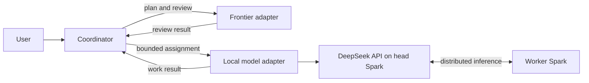

# Product context and decisions

This is the public handoff for Frontier Orchestrator. It describes the current direction rather than every idea in the original October 2026 brief. The developer's local `PROJECT_MEMORY.md` may contain hardware-specific observations and is intentionally excluded from Git.

## Why this exists

Using several models on one job currently means copying prompts and responses between tools, reconstructing context, and reconciling different plans. Frontier Orchestrator should let a user state the outcome once. The application carries one accepted plan, assigns focused work, records what happened, and shows what was checked and what remains uncertain.

Success means a useful result with less manual coordination. A large amount of local-model activity by itself is not success.

## Current role split

- **User:** states the goal and accepts the first plan for the initial workflow.
- **Frontier model:** plans, delegates bounded work, reviews evidence, and requests focused corrections when needed. The first personal integration is a signed-in Codex CLI on the user's Mac.
- **Local model:** handles substantial, well-scoped work. The first integration calls an already-running DeepSeek service through its OpenAI-compatible API.
- **Coordinator:** owns the task record, accepted plan/version, assignments, results, attempt limits, permissions, and event log. Model text is a proposal or result; it does not authorize a file write or shell command.

The current DeepSeek deployment uses two DGX Spark machines to run **one distributed model service**. The head serves one API and the second machine participates in inference. They are not two independently addressable agents in the initial product. Other hardware and local model services should be connectable later through the adapter boundary.

## Build sequence

1. **Existing foundation:** a Node.js coordinator and append-only local event log can show the full handoff with fake model responses. This is a workflow demonstration, not live integration.
2. **First live proof:** from the Mac terminal, give Codex a substantial project-design request. Codex proposes one focused assignment; after the user accepts the plan, DeepSeek answers; Codex reviews the answer and may request one revision. The command displays the answer, review, and final status. See [MVP.md](MVP.md).
3. **Overnight coding proof:** approve a staged plan inside Codex CLI, then execute sequential DeepSeek coding attempts in an isolated Mac Git worktree. Run protected checks and review actual diffs/screenshots; checkpoint accepted stages. Five local attempts precede a last-resort Codex rescue. See [OVERNIGHT.md](OVERNIGHT.md).
4. **Browser view:** a read-only local timeline now shows saved job history, handoffs, checks, and screenshots. Browser controls and broader interface work follow the live model loop.

The current project does not need model installation, Spark runtime management, parallel agents, automatic model selection, team accounts, billing, or long-term memory across unrelated projects.

## Development and release boundaries

Codex is the main development agent for this repository. DeepSeek through OpenCode may provide occasional second reviews while the local service is reachable. That development practice is separate from the application's model adapters.

The Spark deployment and OpenCode tuning belong to a separate project. This repository integrates with an existing API; it should not change model weights, runtime configuration, or server startup as part of app work. Keep credentials and machine-specific network details outside tracked files. As of 2026-10-20, the repository is private with an intent to publish later, so tracked history should already be safe to share.

## Decision history

The original October 2026 “Local AI Orchestrator” brief established the coordination problem and explored several possible model roles, including local-first planning. Those were proposals, not final requirements. Subsequent discussion chose **frontier-led planning and review**, then selected the terminal-based project-design handoff as the first live milestone. An earlier coding-task demo remains the next milestone. When sources differ, use the most recent explicit decision recorded here and in [MVP.md](MVP.md).

## Overnight workflow decision (2026-10-20)

The owner approved the scoped coding milestone: 1–10 ordered stages, five DeepSeek attempts per stage, at most one Codex rescue per exhausted stage and two per job, eight hours by default, and a thirty-minute provider reconnect window. The Mac owns the worktree and check execution. Approvals bind exact plan versions and permissions. Dependencies are prepared beforehand; expansion pauses for a newly approved plan. A disposable React/TypeScript task board is the first pilot. Fake/stub checks can proceed while the Sparks are unavailable; the release gate still requires real Codex/DeepSeek multi-stage execution.
